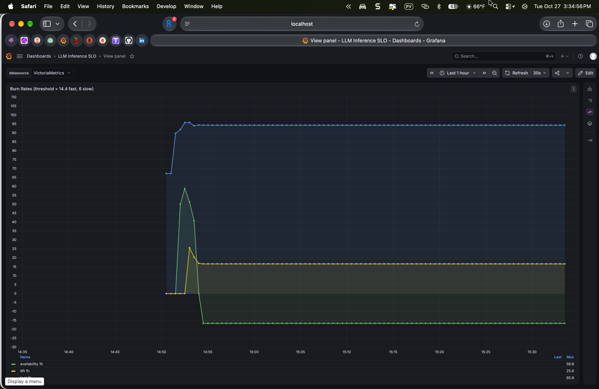
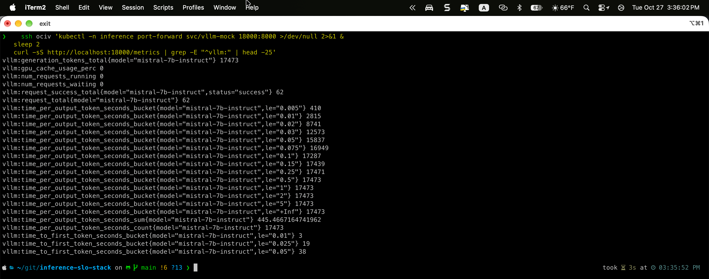
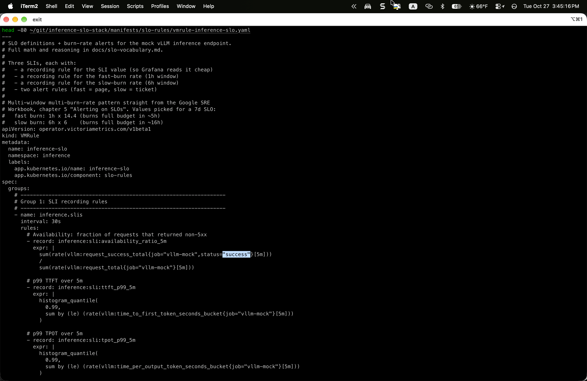

# inference-slo-stack

[](https://github.com/bibigon14/inference-slo-stack/actions/workflows/validate.yml)

SLO + burn-rate alerting for LLM inference endpoints, modelled after the
public vLLM Prometheus surface. Objective: when something degrades the
quality of a hosted LLM API (p99 TTFT drifts past 500ms, token-latency
balloons, cache thrashing), the alerts fire with hours of lead time
instead of minutes of outage.

## Why this project

Every LLM inference deployment eventually hits the same operational
questions. **What is "slow" for a chat completion?** - the right answer
is not p99 end-to-end latency on a conversation of arbitrary length but
two orthogonal signals: *time to first token* (TTFT) and *time per
output token* (TPOT). **When should we page?** - not on single-point
latency spikes, but on error-budget burn-rate crossings, because an
inference endpoint can look fine instant-by-instant while quietly
burning the week's SLO budget. **How do we tell GPU memory from
software-latency problems?** - by correlating `vllm:gpu_cache_usage_perc`
and `vllm:num_requests_waiting` next to the TTFT distribution on one
Grafana pane.

This repo is a reproducible answer. It ships:

- A vLLM-compatible mock inference service that emits the exact same
  Prometheus metric families the real vLLM runtime does (`vllm:time_to_first_token_seconds`,
  `vllm:time_per_output_token_seconds`, `vllm:num_requests_running`,
  `vllm:num_requests_waiting`, `vllm:gpu_cache_usage_perc`,
  `vllm:request_success_total`), with injectable latency and error
  distributions so you can reason about SLO behaviour without burning
  through a $0.526/hr g4dn.xlarge
- A VMRule / PrometheusRule pack with multi-window multi-burn-rate
  alerts straight out of the Google SRE Workbook ("Alerting on SLOs"
  chapter), tuned for the three SLIs that matter for LLM inference
- A Grafana dashboard that puts TTFT, TPOT, request-rate, error-rate,
  queue depth, and KV-cache utilization on one time axis so operators
  stop context-switching between tabs during an incident
- A load generator (k6) with conversation-shaped traffic patterns so
  the demo numbers reflect how LLM traffic actually arrives (bursty,
  long tail of conversation lengths)

Running on the same OCI Ampere A1 VM as `vm-observability`,
`otel-logs-traces-stack`, `kafka-slo-observability`,
`cilium-l7-observability`, and `ebpf-tcp-observer`. Metrics scraped by
the existing VictoriaMetrics stack, alerts fire into the shared
Telegram bridge, dashboards sit next to the SRE kiosk at
sre.dstepanov.dev.

## What's in v0.1

- `vllm-mock` Go service - HTTP endpoint that streams tokens with
  tunable TTFT/TPOT distributions and failure rates, exports realistic
  Prometheus histograms
- `manifests/slo-rules/vmrule-inference-slo.yaml` - the SLO definitions
  and burn-rate alerts (see `docs/slo-vocabulary.md` for the math)
- `manifests/grafana-dashboard/` - unified "LLM Inference SLO"
  dashboard, auto-provisioned via Grafana sidecar
- `manifests/load-gen/k6-script.yaml` - k6 load generator as a CronJob,
  realistic conversation patterns
- `docs/architecture.md` - request flow, OTEL instrumentation points,
  correlation story

## Live on the OCI VM

Deployed end-to-end on the shared Oracle Cloud Ampere A1 free-tier VM.
Screenshots captured during a live run with the k6 CronJob actively
driving traffic:


The burn-rate panel is the operator's "which SLO is on fire" view. In
this capture TPOT is burning at 94.3x the sustainable rate (well above
the 14.4 fast-burn threshold) while availability and TTFT stay quiet -
exactly the signal that lets oncall jump straight to a decode-side
investigation instead of chasing prompt-processing or availability
red herrings:



The vllm-mock service emits the exact vLLM 0.6.x metric families
including `vllm:time_to_first_token_seconds` and
`vllm:time_per_output_token_seconds` histograms with the same bucket
boundaries real vLLM uses, so the SLO rules and dashboards port 1:1
when the mock is swapped for real vLLM:



VMRule as source - the multi-window multi-burn-rate pattern from the
Google SRE Workbook, parameterized by SLI name and threshold. Reads
as one copy of the same rule shape per SLO, which is how a mature SLO
rule library should look:



## What's deliberately out of scope for v0.1

- **Real vLLM** - requires GPU, which costs money and only shifts the
  demo quality upward incrementally. The mock produces the same metric
  shapes so the SLO rules and dashboards are indistinguishable in
  behavior. Swapping in real vLLM in v0.2 is a Deployment-image change.
- **Multi-model routing SLOs** - a production LLM gateway has per-model
  SLIs, routing fallback, cost per 1k tokens. Scoped to a v0.3 after
  the single-endpoint SLO story is clean.
- **Request-content observability** - prompt/completion logging, token
  distribution analytics, drift detection. Separate concern, big enough
  to be its own project.

## Architecture

See [docs/architecture.md](docs/architecture.md) for the request flow,
the OTEL instrumentation points, and the correlation story: how an
alert on `inference:slo:ttft_burn_rate_1h` lands in Grafana already
filtered to the right pod and timeframe.

## SLO vocabulary

See [docs/slo-vocabulary.md](docs/slo-vocabulary.md) for the three SLIs
in play (availability, p99 TTFT, p99 TPOT), the SLOs picked for each,
the error-budget math, and the burn-rate thresholds the alert rules
use (1h × 14.4 fast, 6h × 6 slow - straight from Google SRE Workbook).

## Install

```bash
# Create namespace + core workloads
kubectl apply -f manifests/00-namespace.yaml
kubectl apply -f manifests/vllm-mock/
kubectl apply -f manifests/scraping/
kubectl apply -f manifests/slo-rules/
kubectl apply -f manifests/grafana-dashboard/
kubectl apply -f manifests/load-gen/

# Grafana sidecar auto-reloads the dashboard ConfigMap. If it does not
# show up within 60s, bounce it:
kubectl -n monitoring rollout restart deployment monitoring-grafana
```

Open Grafana, "LLM Inference SLO" dashboard. Burn-rate panel will light
up red when the load generator starts injecting latency.

## Related

- [gpu-observability-eks](https://github.com/bibigon14/gpu-observability-eks) - GPU-side observability (DCGM, standalone nvidia-device-plugin, real vLLM on T4). This repo is the request-side companion.
- [vm-observability](https://github.com/bibigon14/vm-observability) - metrics backend these alerts fire into
- [otel-logs-traces-stack](https://github.com/bibigon14/otel-logs-traces-stack) - logs + traces half; correlation link from alert -> trace -> log is wired up through Grafana datasource links
